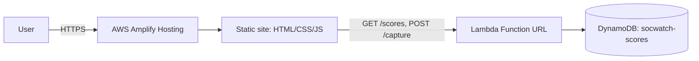

# SOCWatch Portfolio

> **The portfolio that watches you back.**
> Personal portfolio of **Nishen Madava Abedeera** — BSc (Hons) Cyber Security undergraduate (SLTC Research University, Sri Lanka), SOC & penetration testing. Built for the **AWS Student Builder Challenge: Build Your Tech Superpower**.

**Live:** https://main.d2e99c40tngdmx.amplifyapp.com
**Stack:** plain HTML + CSS + vanilla JS · no frameworks, no build step, no CDNs.

---

## The idea
My portfolio *is* a SOC. When you visit, the site starts monitoring you — playfully, never creepily. Three layers ship over the build:

- **Layer A — Live SOC alert feed** that reacts to your actions (scroll, clicks, DevTools…) with severity + MITRE ATT&CK tags.
- **Layer B — Hidden terminal** (`~`) with a real command parser.
- **Layer C — Mini CTF** with 3 flags and a public Blue-Team scoreboard, backed by AWS Lambda + DynamoDB.

> *M0 (this commit) is the minimal live site. Terminal, alert feed and backend arrive in later milestones — see [`docs/PLAN.md`](docs/PLAN.md).*

## Run locally
```bash
npx serve .
# open http://localhost:3000
```
No install needed beyond Node (for `npx serve`). Everything is static.

## Architecture (target)


## Security
- Strict CSP with **zero inline** scripts/styles (`customHttp.yml`), HSTS (preload), `nosniff`, restrictive `Referrer-Policy` and `Permissions-Policy`, `frame-ancestors 'none'`.
- CTF flags validated by **SHA-256 hash** server-side — plaintext flags never in Lambda code.

## Deploy
- **Hosting:** Amplify connects to this repo's `main` branch; every push auto-deploys. Config in `amplify.yml` + `customHttp.yml`.
- **Backend:** one CloudFormation template (`infra/template.yaml`, added in M4) deployed via the AWS console. Steps in `docs/DEPLOY-CONSOLE.md`.

## License
MIT — see [`LICENSE`](LICENSE).
