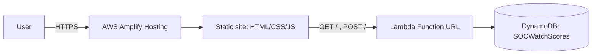

# SOCWatch Portfolio

> **The portfolio that watches you back.**
> Personal portfolio of **Nishen Madava Abedeera** — BSc (Hons) Cyber Security undergraduate (SLTC Research University, Sri Lanka), SOC & penetration testing. Built for the **AWS Student Builder Challenge: Build Your Tech Superpower**.

**Live:** https://main.d2e99c40tngdmx.amplifyapp.com
**Stack:** plain HTML + CSS + vanilla JS · no frameworks, no build step, no CDNs · one WebGL hero on self-hosted Three.js.

---

## The idea
My portfolio *is* a SOC. When you visit, the site plays at monitoring you — friendly, never creepy, and nothing ever leaves your browser. Three layers:

- **Layer A — Live SOC alert feed** (`#soc`): a simulated console that reacts to what you do (theme switch, scroll depth, clipboard copy, idle, terminal activity) and mixes in weighted synthetic SOC events, with severity counters that double as filters and an SVG sparkline.
- **Layer B — Hidden terminal** (press `` ` `` / `~`): a real command parser with history (`↑`/`↓`) and Tab-completion — `help`, `ls`, `cat`, `goto`, `theme`, `ctf`, and more.
- **Layer C — Mini-CTF** (`#ctf`): three hidden flags and a public Blue-Team scoreboard, scored by an **AWS Lambda Function URL + DynamoDB** backend.

See [`docs/HOW-IT-WORKS.md`](docs/HOW-IT-WORKS.md) for the tour and [`docs/PLAN.md`](docs/PLAN.md) for the milestone plan.

## The mini-CTF
Three flags, worth 100 / 150 / 250 points:

1. **recon** — hidden in the HTML source (`view-source:`).
2. **terminal** — open the terminal (`~`), then `ls` → `cat .secret`.
3. **feed** — *earned*: provoke a high-severity alert from the terminal and the SOC escalates, revealing it in the live feed.

Submit them in the **Capture the flag** section. Flags are validated **server-side by SHA-256 digest** — the plaintext never lives in the Lambda source, so reading the code doesn't hand them out.

## Run locally
```bash
npx serve .
# open the printed http://localhost:3000
```
Everything is static; no install beyond Node (for `npx serve`). The WebGL hero and ES-module script need http(s), not `file://`.

## Architecture

Front-end files: `index.html`, `styles.css`, `script.js` (base UI), `terminal.js` (Layer B), `feed.js` (Layer A), `scoreboard.js` (Layer C), `hero3d.js` + `assets/vendor/three-*` (WebGL hero), `config.js` (the backend URL — empty until the backend is deployed; the scoreboard degrades to an offline state).

## Security
- Strict **CSP** with **zero inline** scripts/styles ([`customHttp.yml`](customHttp.yml)), plus HSTS (preload), `X-Content-Type-Options: nosniff`, `Referrer-Policy`, `Permissions-Policy`, `frame-ancestors 'none'`, `base-uri 'self'`. Guarded in CI by [`scripts/check-csp.js`](scripts/check-csp.js).
- The backend fetch stays **blocked by CSP until the Lambda origin is explicitly added to `connect-src`** at deploy time — by design.
- CTF flags validated by **SHA-256 digest** server-side; least-privilege IAM (DynamoDB CRUD on one table).

## Deploy
- **Hosting:** Amplify watches this repo's `main`; every push auto-deploys. Config in [`amplify.yml`](amplify.yml) + [`customHttp.yml`](customHttp.yml). Any new root JS file must be added to `amplify.yml`'s artifact list or it 404s live.
- **Backend:** one CloudFormation template — [`infra/template.yaml`](infra/template.yaml) (SAM/CLI) or [`infra/template-console.yaml`](infra/template-console.yaml) (console, one upload, no CLI). Steps: [`infra/README.md`](infra/README.md) / [`docs/DEPLOY-CONSOLE.md`](docs/DEPLOY-CONSOLE.md).

## License
MIT — see [`LICENSE`](LICENSE).
